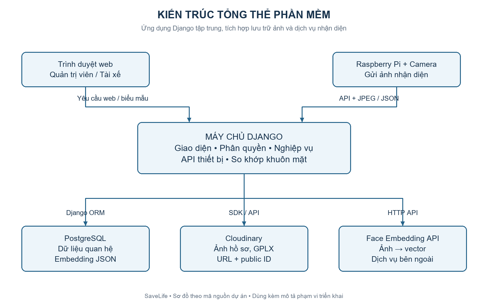
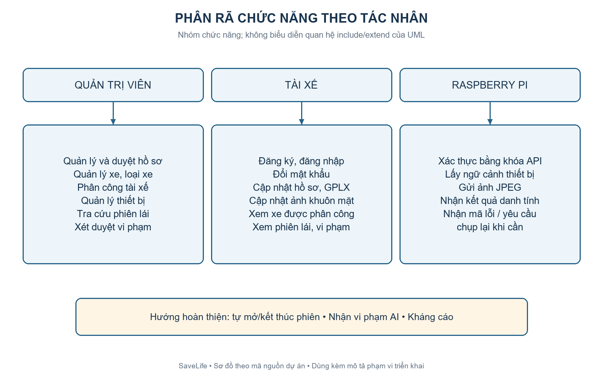
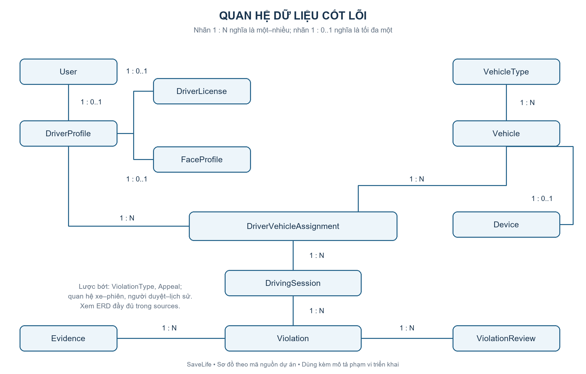
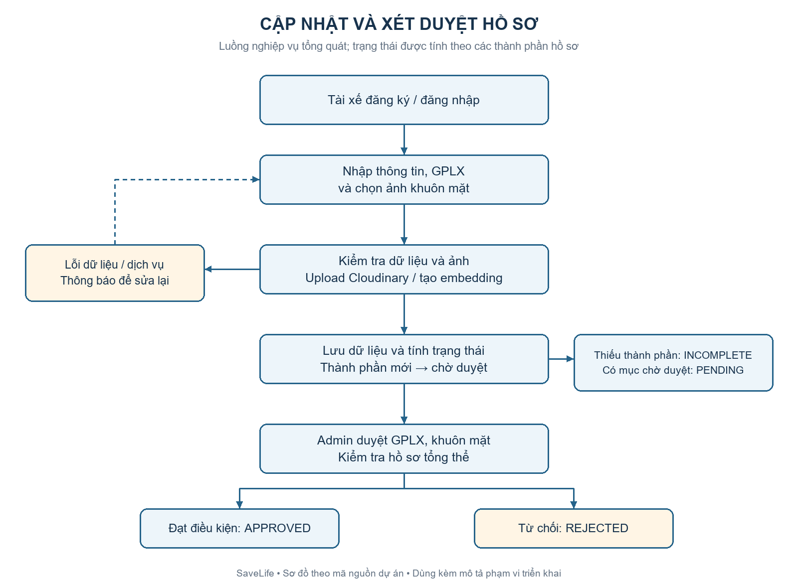
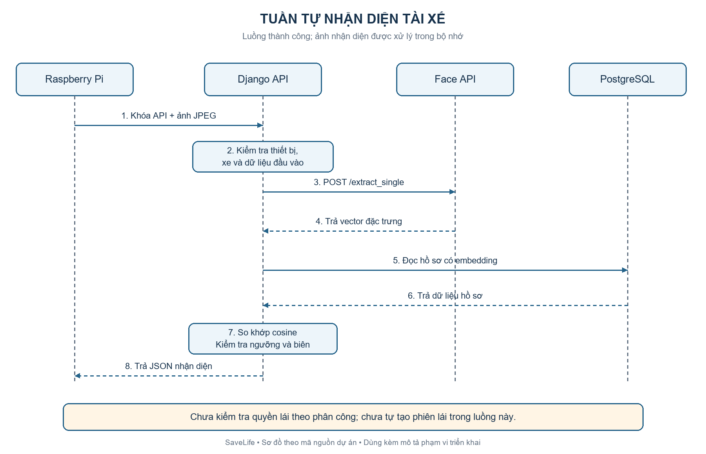
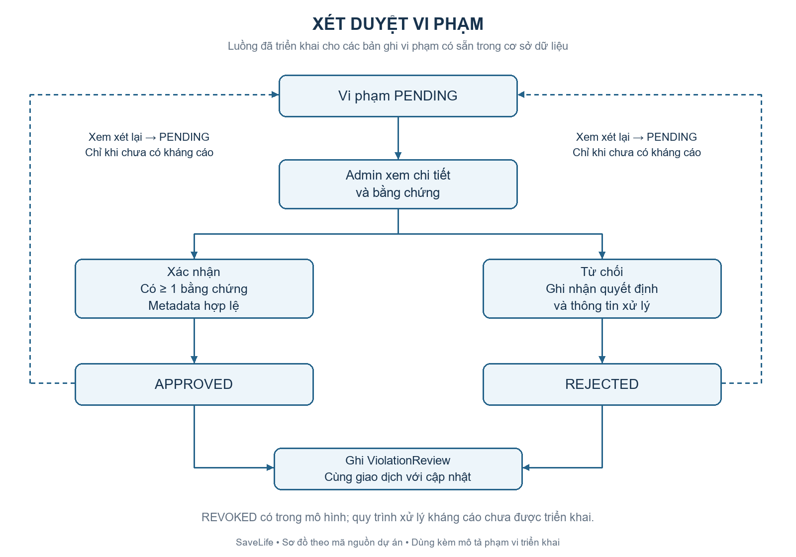

# 2.4. Giải pháp phần mềm

## 2.4.1. Mục tiêu và phạm vi giải pháp

Phần mềm SaveLife được xây dựng nhằm hỗ trợ công ty vận tải quản lý tập trung thông tin tài xế, giấy phép lái xe (GPLX), phương tiện, phân công sử dụng xe và lịch sử hoạt động. Hệ thống kết hợp giao diện web quản trị với API giao tiếp thiết bị Raspberry Pi, tạo nền tảng cho việc nhận diện tài xế và quản lý các sự kiện vi phạm trong quá trình lái xe.

Hệ thống có hai nhóm người dùng chính: quản trị viên (ADMIN) và tài xế (USER). Quản trị viên quản lý dữ liệu dùng chung, xét duyệt hồ sơ, phân công phương tiện và xử lý vi phạm. Tài xế cập nhật thông tin cá nhân, GPLX, ảnh khuôn mặt và tra cứu dữ liệu thuộc phạm vi của mình. Thiết bị Raspberry Pi là thành phần tích hợp, gửi ảnh phục vụ nhận diện thông qua API riêng.

Giải pháp hướng đến việc tập trung quy tắc nghiệp vụ tại máy chủ, phân quyền theo người dùng và bảo toàn dữ liệu lịch sử. Việc phát triển được chia thành các mô-đun để thuận tiện kiểm thử, bảo trì và bổ sung chức năng. Phạm vi hiện tại phục vụ một công ty vận tải.

Nội dung dưới đây mô tả thiết kế phần mềm và đối chiếu với mã nguồn tại thời điểm lập báo cáo. Những chức năng thuộc định hướng mở rộng được ghi rõ để phân biệt với các chức năng đã triển khai.

## 2.4.2. Kiến trúc tổng thể

Hệ thống sử dụng kiến trúc ứng dụng web tập trung. Trình duyệt gửi yêu cầu đến máy chủ Django; máy chủ thực hiện xác thực, kiểm tra quyền, xử lý nghiệp vụ và truy cập cơ sở dữ liệu PostgreSQL thông qua Django ORM. Giao diện được kết xuất ở phía máy chủ bằng Django Templates, kết hợp HTML, CSS và JavaScript để tổ chức nội dung và hỗ trợ thao tác của người dùng.

Các tệp ảnh GPLX và ảnh hồ sơ khuôn mặt được lưu trên Cloudinary. Cơ sở dữ liệu lưu đường dẫn, mã định danh tệp và các thông tin liên quan. Dịch vụ Face Embedding bên ngoài tiếp nhận ảnh và trả về vector đặc trưng; Django sử dụng vector này để lưu hồ sơ hoặc so khớp danh tính. Mã hiện tại sử dụng JSONField để lưu embedding.

Raspberry Pi giao tiếp với Django qua API thiết bị. Trong luồng nhận diện, ảnh JPEG được tiếp nhận trong bộ nhớ và chuyển đến dịch vụ trích xuất đặc trưng. Django so sánh vector truy vấn với dữ liệu đã lưu và trả kết quả về thiết bị. Ảnh chụp nhận diện của luồng này không được đưa vào quy trình lưu ảnh hồ sơ trên Cloudinary.

Kiến trúc trên phân tách giao diện, xử lý nghiệp vụ, lưu trữ dữ liệu và dịch vụ nhận diện. Các mô-đun nghiệp vụ hiện cùng nằm trong một ứng dụng Django; Cloudinary và Face Embedding là các dịch vụ tích hợp bên ngoài. Đây là kiến trúc ứng dụng nguyên khối được tổ chức theo mô-đun, phù hợp với phạm vi đồ án.

## 2.4.3. Công nghệ và tổ chức mã nguồn

| Thành phần | Công nghệ sử dụng trong dự án | Vai trò |
| --- | --- | --- |
| Máy chủ ứng dụng | Python, Django 5.2 theo requirements.txt | Xử lý yêu cầu, xác thực, phân quyền và nghiệp vụ |
| Giao diện web | Django Templates, HTML, CSS, JavaScript | Hiển thị trang và biểu mẫu tương tác |
| Cơ sở dữ liệu | PostgreSQL, Django ORM | Lưu dữ liệu quan hệ và thực thi ràng buộc |
| Lưu trữ ảnh | Cloudinary | Lưu ảnh hồ sơ và ảnh GPLX; hỗ trợ thiết kế lưu bằng chứng |
| Tích hợp nhận diện | requests, API Face Embedding | Gửi ảnh và nhận vector đặc trưng |
| Kiểm tra ảnh | Pillow | Kiểm tra định dạng và kích thước ảnh |
| Đăng nhập web | Django session authentication | Quản lý phiên đăng nhập người dùng |
| Giao tiếp thiết bị | HTTP/HTTPS, JSON, multipart/form-data | Gửi ảnh và nhận phản hồi có cấu trúc |

Django được sử dụng để tận dụng cơ chế xác thực, biểu mẫu, ORM và quản lý giao dịch sẵn có. PostgreSQL phù hợp với cấu trúc dữ liệu có nhiều quan hệ và yêu cầu bảo toàn lịch sử. Cloudinary giúp tách lưu trữ ảnh khỏi cơ sở dữ liệu nghiệp vụ. Việc sử dụng API tạo embedding cho phép phần mềm tập trung vào quản lý và tích hợp, trong khi thuật toán trích xuất đặc trưng do dịch vụ nhận diện đảm nhiệm.

Mã nguồn được tổ chức thành các nhóm: accounts quản lý tài khoản và hồ sơ; vehicles quản lý phương tiện, thiết bị và phân công; driving quản lý mô hình phiên lái và API nhận diện; violations quản lý vi phạm, bằng chứng và lịch sử xét duyệt. Thư mục frontend chứa định tuyến, view và biểu mẫu phục vụ giao diện web; templates và static chứa tài nguyên hiển thị.

Giao diện đang hoạt động sử dụng các trang Django động. Phần JavaScript prototype còn trong kho mã nguồn không đại diện cho kiến trúc giao diện đang được sử dụng. API thiết bị được viết bằng Django view và JsonResponse; dự án hiện không khai báo Django REST Framework trong requirements.txt.

## 2.4.4. Phân rã chức năng và phân quyền

| Nhóm chức năng | Nội dung chính | Người sử dụng |
| --- | --- | --- |
| Tài khoản | Đăng ký, đăng nhập, đăng xuất, đổi mật khẩu | Tài xế, quản trị viên |
| Hồ sơ tài xế | Thông tin cá nhân, ảnh khuôn mặt, trạng thái xét duyệt | Tài xế cập nhật; quản trị viên duyệt |
| GPLX | Ảnh hai mặt, thông tin giấy phép, hiệu lực và trạng thái duyệt | Tài xế cập nhật; quản trị viên duyệt |
| Phương tiện | Danh mục loại xe, thông số xe, trạng thái sử dụng | Quản trị viên; tài xế xem xe được giao |
| Phân công | Gán tài xế cho xe theo thời gian, kết thúc phân công | Quản trị viên |
| Thiết bị | Quản lý thiết bị gắn với xe và khóa API | Quản trị viên |
| Nhận diện | Gửi ảnh, tạo embedding, so khớp và trả danh tính | Raspberry Pi thông qua API |
| Phiên lái | Tra cứu lịch sử phiên đã có trong cơ sở dữ liệu | Quản trị viên; tài xế xem phiên của mình |
| Vi phạm | Tra cứu, xem bằng chứng, xác nhận, từ chối, xem xét lại | Quản trị viên; tài xế xem dữ liệu được phép |

Quyền truy cập được kiểm tra tại máy chủ. Tài xế chỉ được xem các phiên lái của mình và những vi phạm thuộc phạm vi cho phép; hiện giao diện tài xế hiển thị vi phạm ở trạng thái PENDING hoặc APPROVED. Quản trị viên có quyền quản lý và xét duyệt. Việc ẩn hoặc hiện nút trên giao diện được kết hợp với kiểm tra quyền ở phía Django.

Các chức năng tự động tạo/kết thúc phiên lái từ thiết bị, tiếp nhận vi phạm từ AI và gửi/xử lý kháng cáo thuộc phần cần hoàn thiện. Giao diện phiên lái hiện phục vụ tra cứu, chưa cung cấp thao tác bắt đầu hoặc kết thúc phiên.

## 2.4.5. Thiết kế dữ liệu

Dữ liệu được tổ chức theo mô hình quan hệ, gồm 14 thực thể nghiệp vụ chính. Các bảng xác thực và phiên đăng nhập do Django cung cấp không nằm trong số 14 thực thể này.

| Nhóm | Thực thể | Dữ liệu quản lý |
| --- | --- | --- |
| Tài xế | User, DriverProfile, DriverLicense, FaceProfile | Tài khoản, thông tin cá nhân, GPLX, ảnh và vector khuôn mặt |
| Phương tiện | VehicleType, Vehicle, Device | Loại xe, phương tiện và thiết bị gắn trên xe |
| Hoạt động | DriverVehicleAssignment, DrivingSession | Phân công theo thời gian và lịch sử phiên lái |
| Vi phạm | ViolationType, Violation, Evidence | Danh mục vi phạm, sự kiện và metadata bằng chứng |
| Xử lý sau ghi nhận | ViolationReview, Appeal | Lịch sử xét duyệt và dữ liệu kháng cáo |

Mỗi tài khoản có tối đa một hồ sơ tài xế; mỗi hồ sơ có tối đa một bản ghi GPLX và một hồ sơ khuôn mặt hiện tại. Quan hệ tùy chọn cho phép tài khoản mới tồn tại trước khi người dùng hoàn thành hồ sơ. Tài xế và xe có quan hệ nhiều–nhiều thông qua DriverVehicleAssignment. Phân công lưu thời điểm bắt đầu, kết thúc và là cơ sở liên kết với các phiên lái.

Một phiên lái có thể phát sinh nhiều vi phạm. Mỗi vi phạm thuộc một loại và có thể có nhiều bằng chứng, nhiều bản ghi xét duyệt, nhưng tối đa một kháng cáo. Bằng chứng lưu URL và metadata; sự tồn tại của mô hình Evidence chưa đồng nghĩa với việc đã có API tiếp nhận hoặc upload bằng chứng.

DrivingSession có thêm khóa ngoại vehicle để áp dụng ràng buộc mỗi xe chỉ có một phiên STARTED. Giá trị này được đồng bộ từ phân công khi lưu. Violation không lưu lặp tài xế và xe mà truy xuất thông qua phiên lái và phân công. Mô hình bảo vệ tham chiếu lịch sử, đồng thời kiểm tra sự nhất quán giữa trạng thái và thời gian của phiên lái.

Sơ đồ trong hình thể hiện các quan hệ cốt lõi để dễ trình bày. Bản Mermaid ERD đi kèm thể hiện đủ 14 thực thể và các quan hệ, bao gồm Vehicle–DrivingSession và User–ViolationReview.

## 2.4.6. Các luồng xử lý chính

### a) Cập nhật và xét duyệt hồ sơ

Sau khi đăng ký, tài xế bổ sung thông tin cá nhân, GPLX và ảnh khuôn mặt. Máy chủ kiểm tra dữ liệu, tải ảnh lên Cloudinary và gọi API tạo embedding đối với ảnh khuôn mặt. Khi các bước xử lý thành công, dữ liệu được ghi vào cơ sở dữ liệu. Thay ảnh khuôn mặt hoặc cập nhật GPLX sẽ đưa thành phần tương ứng về trạng thái chờ duyệt.

Quản trị viên kiểm tra GPLX và khuôn mặt trước khi duyệt hồ sơ tổng thể. Hệ thống sử dụng các trạng thái INCOMPLETE, PENDING, APPROVED và REJECTED để biểu diễn tình trạng hồ sơ. Khi có thành phần đang chờ duyệt, trạng thái PENDING được ưu tiên hiển thị; vì vậy PENDING không tự khẳng định rằng hồ sơ đã đầy đủ. Việc duyệt hồ sơ tổng thể vẫn phải kiểm tra đầy đủ các điều kiện.

Các thao tác cập nhật và xét duyệt kiểm tra phiên bản bản ghi để phát hiện trường hợp dữ liệu đã bị thay đổi sau khi người dùng mở trang. Với quy trình thay ảnh, ảnh cũ chỉ được dọn sau khi giao dịch lưu dữ liệu thành công; ảnh mới được dọn nếu lưu thất bại theo cơ chế xử lý lỗi của dịch vụ.

### b) Nhận diện tài xế từ Raspberry Pi

Thiết bị gửi yêu cầu đến POST /api/v1/device/face-verifications/ kèm khóa API và ảnh JPEG. Máy chủ kiểm tra xác thực thiết bị, trạng thái thiết bị và xe, cấu trúc yêu cầu và tính hợp lệ của ảnh. Sau đó ảnh được gửi đến dịch vụ /extract_single để nhận vector khuôn mặt.

Django tính độ tương đồng cosine giữa vector truy vấn q và từng vector hồ sơ e: similarity(q,e) = (q·e) / (||q|| × ||e||). Các kết quả được sắp xếp giảm dần. Ứng viên tốt nhất phải đạt ngưỡng cấu hình; nếu có ứng viên thứ hai, khoảng cách giữa hai điểm số phải lớn hơn biên phân biệt cấu hình. Trường hợp không đạt ngưỡng hoặc hai ứng viên quá gần nhau, máy chủ trả kết quả chưa xác định và yêu cầu chụp lại.

Ngưỡng nhận diện cần được hiệu chỉnh theo mô hình và dữ liệu thử nghiệm, chưa thể suy ra độ chính xác thực tế từ mã nguồn. Điểm cosine là độ tương đồng, không phải xác suất nhận diện đúng. Dự án không cung cấp kết quả đo để khẳng định tỷ lệ chính xác hoặc thời gian đáp ứng trong báo cáo này.

Trong phiên bản hiện tại, việc tìm kiếm được thực hiện trên toàn bộ tài xế có embedding. Luồng này chưa lọc ứng viên theo phân công, trạng thái duyệt hồ sơ hoặc hiệu lực GPLX và chưa tự tạo DrivingSession. Kết quả DRIVER_VERIFIED biểu thị kết quả so khớp danh tính; việc xác định quyền lái xe cần được bổ sung bằng bước kiểm tra nghiệp vụ riêng.

### c) Xét duyệt vi phạm

Quản trị viên mở chi tiết vi phạm, xem thông tin và bằng chứng, sau đó xác nhận hoặc từ chối. Chỉ bản ghi PENDING được xử lý trực tiếp. Thao tác xác nhận yêu cầu có ít nhất một bằng chứng và metadata của tất cả bằng chứng phải hợp lệ. Việc kiểm tra metadata không đồng nghĩa với kiểm chứng nội dung tệp hay khả năng truy cập đường dẫn bên ngoài.

Mỗi quyết định được ghi vào ViolationReview cùng người xử lý, thời điểm và dữ liệu trước/sau. Việc cập nhật vi phạm và ghi lịch sử nằm trong cùng giao dịch. Chức năng xem xét lại đưa bản ghi đã xử lý về PENDING, nhưng hiện bị chặn nếu vi phạm đã có kháng cáo. Trạng thái REVOKED đã có trong mô hình; luồng tự động chuyển sang trạng thái này khi chấp nhận kháng cáo chưa triển khai.

## 2.4.7. Bảo vệ dữ liệu và xử lý lỗi

Hệ thống sử dụng cơ chế mật khẩu và phiên đăng nhập của Django. Các biểu mẫu ghi dữ liệu trên web sử dụng POST, CSRF và kiểm tra quyền phía máy chủ. API thiết bị dùng khóa riêng; mã nguồn có cơ chế kiểm tra khóa và đọc lại thông tin thiết bị sau khi dịch vụ nhận diện phản hồi để phát hiện thay đổi khóa hoặc thay đổi xe gắn với thiết bị.

Tính nhất quán được bảo vệ bằng kiểm tra dữ liệu đầu vào, ràng buộc cơ sở dữ liệu và giao dịch. Các quy tắc tiêu biểu gồm mỗi xe chỉ có một phiên STARTED, phiên ENDED phải có thời điểm kết thúc hợp lệ, không đổi liên kết lịch sử của phiên đã tạo và mỗi vi phạm có tối đa một kháng cáo. Kháng cáo có cơ chế xóa mềm để giữ ràng buộc một lần khi xóa riêng bản ghi.

Ảnh tải lên được kiểm tra định dạng và giới hạn kích thước. API nhận diện trả phản hồi có mã kết quả, thông điệp, request_id và hướng xử lý cho thiết bị. Các lỗi như ảnh không hợp lệ, dịch vụ nhận diện không phản hồi hoặc vector không hợp lệ được tách biệt để hỗ trợ xử lý và thử lại.

Khi triển khai thực tế, cần hoàn thiện cấu hình vận hành như HTTPS, khóa bí mật, chế độ debug, danh sách máy chủ được phép, sao lưu và quản lý quyền truy cập dữ liệu. Cấu hình hiện tại phục vụ phát triển và thử tích hợp; không xem đó là cấu hình vận hành chính thức. Nội dung này là yêu cầu triển khai, chưa phải kết quả đã kiểm chứng.

## 2.4.8. Phạm vi đã triển khai và hướng hoàn thiện

| Hạng mục | Hiện trạng theo mã nguồn |
| --- | --- |
| Tài khoản và hồ sơ | Có giao diện, lưu dữ liệu, upload ảnh, tạo embedding và xét duyệt |
| Xe, loại xe, phân công, thiết bị | Có chức năng quản lý và kiểm tra nghiệp vụ |
| API nhận diện từ Raspberry Pi | Có xác thực thiết bị, nhận ảnh, gọi dịch vụ và so khớp danh tính |
| Phiên lái | Có mô hình, ràng buộc và giao diện tra cứu; chưa có luồng tự mở/kết thúc từ thiết bị |
| Vi phạm và xét duyệt | Có mô hình, giao diện tra cứu, xác nhận/từ chối và lịch sử xử lý |
| Nhận vi phạm từ AI, upload bằng chứng | Chưa triển khai endpoint tiếp nhận |
| Kháng cáo | Có mô hình và xóa mềm; chưa có giao diện gửi/xử lý |
| Embedding | Lưu bằng JSONField; chưa sử dụng pgvector |
| Giám sát thiết bị | API cập nhật last_seen_at khi xác thực; chưa có cơ chế heartbeat định kỳ hoàn chỉnh |
| Livestream và cảnh báo mở rộng | Thuộc định hướng phát triển |

Hướng hoàn thiện tiếp theo là nối kết quả nhận diện với bước kiểm tra điều kiện lái xe, gồm tài khoản, hồ sơ đã duyệt, GPLX, phân công còn hiệu lực, trạng thái phương tiện và phiên đang hoạt động. Sau đó xây dựng giao thức bắt đầu/kết thúc phiên, API tiếp nhận vi phạm và bằng chứng, cùng quy trình kháng cáo. Các bước này cần được kiểm thử trước khi mô tả hệ thống là đã vận hành tự động toàn bộ.

## Ghi chú biên tập — bỏ phần này khi chép vào báo cáo

- Đây là sườn có nội dung mẫu, có thể rút gọn theo số trang của nhóm. Nếu mục 2.4 chỉ yêu cầu giải pháp đề xuất, giữ các phần 2.4.1–2.4.4 và tóm tắt các phần còn lại.
- Số hình 2.4-1 đến 2.4-6 là số tạm; đổi theo quy tắc đánh số hình của báo cáo chung.
- PNG dùng để chèn vào Word; SVG dùng khi cần phóng to; Mermaid trong thư mục sources dùng để chỉnh sửa nội dung sơ đồ. Các hình là sơ đồ thiết kế, không phải ảnh chụp giao diện.
- Không ghi thêm các tỷ lệ chính xác AI, thời gian phản hồi hay kết quả thử tải nếu nhóm chưa đo thực tế.
- Nguồn đối chiếu nội bộ: requirements.txt; config/settings.py; config/urls.py; frontend/urls.py; frontend/views.py; accounts/models.py; accounts/profile_services.py; vehicles/models.py; driving/models.py; driving/device_api.py; driving/face_verification.py; violations/models.py; violations/services.py; FRONTEND.md. Khi tài liệu mô tả khác với triển khai, nội dung trên ưu tiên mã nguồn.
